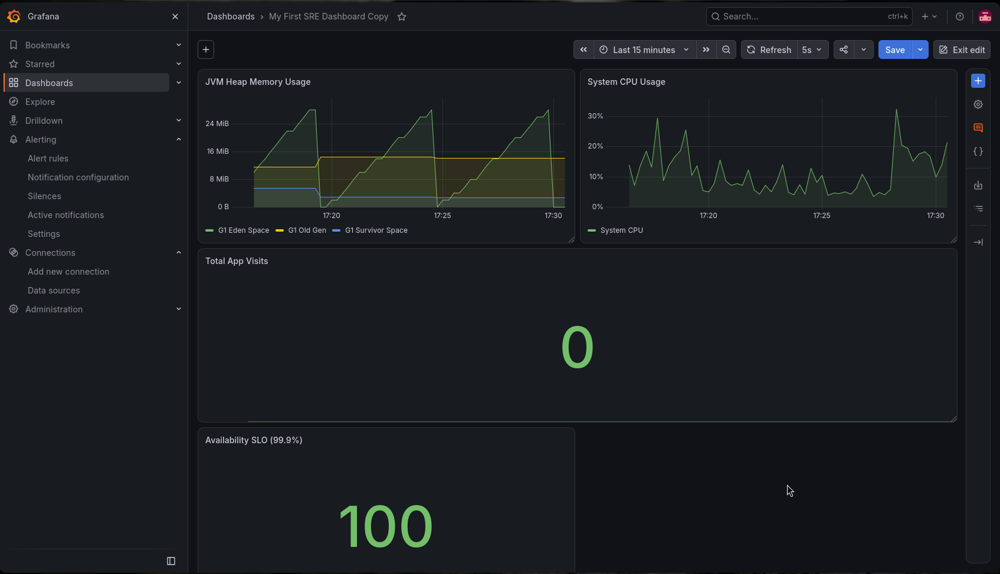

# Java SRE Observability Lab

A production-grade Site Reliability Engineering (SRE) lab demonstrating containerization, observability, alerting, and CI/CD.

## Architecture
This stack is fully containerized using Docker Compose:
- **Application:** Java Spring Boot (Instrumented with Micrometer)
- **Metrics Collection:** Prometheus (Scrapes every 5 seconds)
- **Visualization:** Grafana (Dashboards as Code)
- **Alerting:** Alertmanager + Discord Bridge
- **CI/CD:** GitHub Actions (Automated Java Build)
- **Load Testing:** k6

## Dashboard Preview

*(A live view of JVM Memory, System CPU, App Visits, and the 99.9% Availability SLO).*

## Features Demonstrated
- **Observability:** Exposed custom `/hello` endpoint metrics and tracked real-time HTTP status codes.
- **SLO Tracking:** Calculated a real-time 99.9% Availability SLO directly in PromQL.
- **Incident Response:** Configured Prometheus alert rules to fire a `[FIRING]` and `[RESOLVED]` message to Discord if the app goes down.
- **Infrastructure as Code (IaC):** Rebuilt the Java app into a multi-stage `Dockerfile` for a lightweight and secure production image.
- **Secrets Management:** Handled Discord webhook secrets securely using `.env` files and `.gitignore`.
- **CI/CD Pipeline:** Automated cloud builds using GitHub Actions to ensure code always compiles.

## How to Run This Locally

1. **Clone the repo:**
   git clone https://github.com/ALTMANhehe/java-sre-observability.git
   cd java-sre-observability

2. **Setup secrets:**
   Create a .env file in the root directory and add your Discord webhook:
   DISCORD_WEBHOOK=https://discord.com/api/webhooks/YOUR_URL_HERE

3. **Start the entire stack:**
   docker compose up -d --build

4. **Access the Service:**
    - App: http://localhost:8080/hello
    - Prometheus: http://localhost:9090
    - Grafana: http://localhost:3000 (admin/admin)
    - Alertmanager: http://localhost:9093

## Load Testing
To test the capacity of the container, run the included k6 script:
```
docker run --rm -i --network host grafana/k6 run - < load_test.js
```
